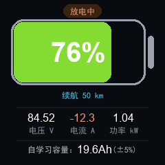
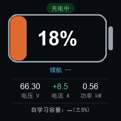
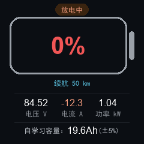
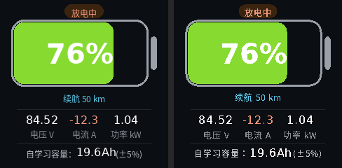

# 库仑计屏幕 UI 代码（ST7789 240×240 · LVGL）

48V~92V 电动车/储能库仑计的屏幕界面代码（LVGL v8 实现）。核心是横置手机样式电池条 +
大字 SOC，下方三列电压/电流/功率与自学习容量。

<p align="center">
  
  
  
  <br>
  <sub>实机渲染：放电 76% ｜ 充电 18%（容量未标定）｜ 空电 0% 告警</sub>
</p>

> 以上 PNG 不是手工画的示意图，而是把下面 C 代码的绘图逻辑**逐像素复刻**后
> 渲染出来的（见 [渲染验证](#渲染验证)），所以和烧进板子的效果一致。

## 显示内容

| 区域 | 显示 |
|---|---|
| 顶部胶囊 | 放电中 / 充电中 |
| 电池条 + 大字 | 当前 SOC 百分比（0~100），颜色红→绿随电量渐变 |
| 续航 | 预计里程 km，无数据源时显示 `--` |
| 三列小字 | 实时电压 V / 电流 A / 功率 kW |
| 底部一行 | 满充满放自学习容量（未标定时 `--`） |

## 布局坐标表

| 区域 | x / y / 尺寸 |
|---|---|
| 状态胶囊 | 92, 6, 56×20 |
| 电池外壳 | 16, 28, 196×96（描边 3px） |
| 电池填充条 | 20, 32, 宽 = 188×SOC%，高 88 |
| SOC 大字 | 叠在电池正中，Montserrat 40 |
| 预计续航 | 居中，y=130，中文 12px |
| 分隔线 | y=156 / y=204，x 24~216 |
| 电压/电流/功率 | 三列居中于 x=60/120/180，数值 16px + 标签 12px |
| 自学习容量 | 底部居中行：说明(12px) + 数值(16px) + 误差(12px) |

## SOC 颜色公式

色相 = `SOC × 1.2°`（0% 深红 → 100% 纯绿），两端和手机电量条一致；SOC ≤ 10% 时数字额外转红告警。

LVGL v8 写法：

```c
lv_color_t c = lv_color_hsv_to_rgb(soc * 12 / 10, 78, 86);
```

⚠️ 注意 LVGL v8 这个函数是**直接返回颜色、没有输出参数**，且 **s/v 只接受 0~100 的百分比**，
传 0~255 会让颜色溢出成白色（详见下方[渲染验证](#渲染验证)）。

## 文件结构

```
.
├── ui.h                  # LVGL版对外接口（ui_data_t + ui_init/ui_update）
├── ui_lvgl.c             # LVGL v8 实现
├── ui_raw_v2.h/.c        # 裸机V2：颜色/钳位/初始化（零LVGL依赖，G431直用）
├── ui_raw_draw.c         # 裸机V2：全屏重画（布局与LVGL 1:1）
├── gfx_raw.h/.c          # 裸机2D原语：圆角矩形/描边/1-bit文字直刷
├── font_raw.h            # 1-bit点阵子集（fontgen.py生成，~4KB Flash）
├── fontgen.py            # 字库生成器（Noto CJK 12px + DejaVu 16/40px）
├── st7789_port.c         # G431 SPI+DMA移植模板（改引脚即用）
├── render_verify.py      # LVGL绘图逻辑复刻 → PNG验证
├── raw_canvas.py         # 裸机V2渲染核心（复刻gfx_raw.c）
├── raw_draw.py           # 裸机V2整屏渲染（复刻ui_raw_draw.c）
├── render_raw_main.py    # 输出裸机预览 + LVGL并排对比
├── images/               # 各状态渲染图 + 对比图（README引用）
└── README.md
```

## 生成中文子集字库

界面用到的汉字一共十几个：放电压流功率续航自学习容量误差充中±%()：。用 lv_font_conv 生成 12px 子集，约 2~3KB flash：

```bash
lv_font_conv --font SourceHanSansCN-Regular.ttf \
             --size 12 --bpp 4 --format lvgl \
             --symbols "放电压流功率续航自学习容量误差充中±%()：" \
             -r 0x20-0x7E \
             -o font_cn_12.c
```

把 `font_cn_12.c` 加入工程，`lv_conf.h` 里打开：

```c
#define LV_FONT_MONTSERRAT_16   1
#define LV_FONT_MONTSERRAT_40   1
#define LV_COLOR_DEPTH          16
```

`ui_lvgl.c` 里用到了 `lv_snprintf`，需保证 `LV_USE_LABEL 1`（默认开）。

## 裸机 V2（G431 直用，与 LVGL 同界面）

<p align="center">
  
  <br>
  <sub>左=LVGL复刻 ｜ 右=裸机V2复刻（差异~7%，仅抗锯齿/字形）</sub>
</p>

零 LVGL 依赖，`RAM ~0（无帧缓冲）`，`Flash ~14KB（含4KB字库）`，`G431K8(64KB/32KB)` 随便装：

```c
ui_raw_data_t d = {0};
d.soc = 76.0f; d.voltage = 84.52f; d.current = -12.3f;
d.power_kw = 1.04f; d.capacity_ah = 19.6f; d.range_km = 50; d.charging = 0;

ui_raw_init();              /* 上电一次，需先 ST7789_Init() */
while (1) {
    /* 每500ms置 refresh 式调用：直接 ui_raw_update(&d) 全屏重画 */
    ui_raw_update(&d);
    HAL_Delay(500);
}
```

移植只改 `st7789_port.c` 引脚+`SPI`句柄，实现 `SetWindow/PushPixels/PushPixelsSolid` 即可。
字库再生：`python3 fontgen.py`（需 `NotoSansCJK + DejaVu`，`Ubuntu` 自带）。
对比验证：`python3 render_raw_main.py` → `images/compare_*.png`（左LVGL右裸机+diff率）。

## 渲染验证（render_verify.py）

`render_verify.py` 在 PC 上逐像素复刻了 `ui_lvgl.c` 的绘图逻辑，输出标准 LVGL 图片源
（RGB565 240×240），再用 `lvgl_image_viewer` 技能转成 PNG 做视觉核对，
同时打印布局体检报告（越界/裁剪/溢出）。

```bash
python render_verify.py
python <lvgl_image_viewer.py 路径> . -o ./png_out/ --overwrite
```

验证中发现并已修复的两个真问题：

1. **`lv_color_hsv_to_rgb` 量纲错误**。LVGL v8 的签名是
   `lv_color_t lv_color_hsv_to_rgb(uint16_t h, uint8_t s, uint8_t v)` ——
   **直接返回颜色，不是输出参数**，且 **s/v 的合法范围是 0~100（百分比）**。
   写成 `lv_color_hsv_to_rgb(h, 200, 220, &color)` 会让填充条变成惨白色。
   正确写法：`lv_color_t c = lv_color_hsv_to_rgb(soc * 12 / 10, 78, 86);`

2. **中文容量行会满溢**。中文是全角等宽，原文案「满充满放自学习容量：19.6Ah(±5%误差)」
   在 12px 下宽 231px，容量到 `100.0Ah` 时正好 240px = 屏宽，边缘被裁。
   已改为「自学习容量：19.6Ah(±5%)」，最坏情况 168px，余量 72px。

## 接入主循环

```c
ui_data_t d = {0};
d.soc = 76.0f; d.voltage = 84.52f; d.current = -12.3f;
d.power_kw = 1.04f; d.capacity_ah = 19.6f; d.range_km = 50; d.charging = 0;

ui_init();            /* 初始化时调一次 */

while (1) {
    /* 100ms 采样一次：读 ADS1115 → 软件积分 → 填 d → 每 500ms 刷一次屏 */
    ui_update(&d);
    HAL_Delay(100);
}
```

## 注意

- 实测容量 `capacity_ah` 未标定时传 `-1`，界面显示 `--`，别传 0。
- 续航 `range_km` 没有距离来源时传 `-1`，显示 `--`（可选方案：控制器速度信号 / GPS / 手动学电耗）。
- 电流符号在界面里按充放方向强制（充电 `+`、放电 `-`），模拟链路的正负由固件内部统一。
- 底部容量行经实测最坏情况（`100.0Ah`）宽 168px，屏宽 240px，余量 72px；若你把文案加长，注意全角汉字是等宽的。

## 许可

MIT — 随意用、随意改，商业使用无限制。
